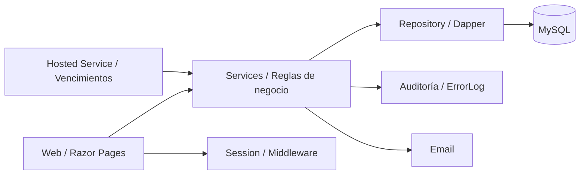
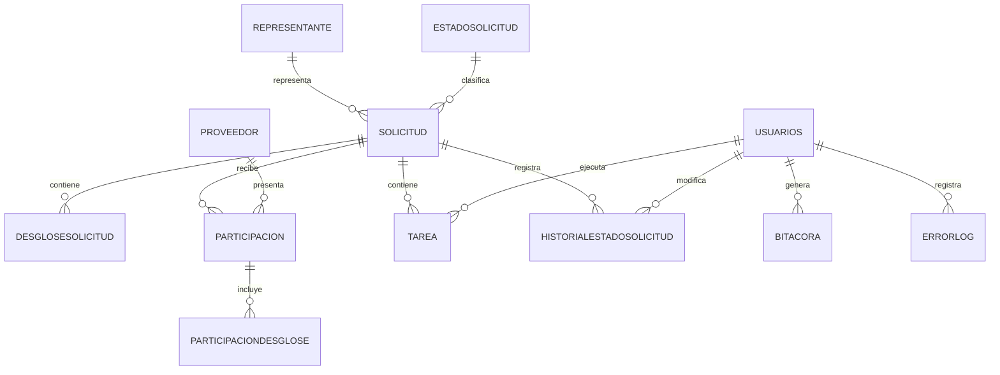

# Administración de Solicitudes

Sistema web para centralizar y automatizar la gestión de solicitudes de una organización, sustituyendo el manejo manual en Excel por una plataforma con autenticación, trazabilidad, control de estados, tareas, reportes, auditoría y notificaciones.

El proyecto fue desarrollado con **ASP.NET Core Razor Pages sobre .NET 10**, arquitectura por capas, **Dapper** y **MySQL**.

> **Estado actual:** las historias **USR1–USR4, SOL1–SOL7 y TAR1–TAR3** se encuentran integradas. La solución compila correctamente y se encuentra en pruebas funcionales finales.

---

## Contenido

- [Objetivo](#objetivo)
- [Tecnologías](#tecnologías)
- [Arquitectura](#arquitectura)
- [Estructura](#estructura)
- [Historias implementadas](#historias-implementadas)
- [Auditoría](#auditoría)
- [Seguridad](#seguridad)
- [Base de datos](#base-de-datos)
- [Configuración](#configuración)
- [Ejecución](#ejecución)
- [Pruebas](#pruebas)
- [Decisiones técnicas](#decisiones-técnicas)
- [Flujo Git](#flujo-git)

---

## Objetivo

La aplicación permite administrar el ciclo completo de solicitudes de trabajo de una organización:

- Autenticación y sesión.
- Administración de usuarios.
- Administración de solicitudes.
- Administración de representantes y estados.
- Registro de desgloses mensuales y costos.
- Vencimiento automático.
- Notificaciones por correo.
- Registro de tareas y horas.
- Reportes mensuales de facturación.
- Reportes de tareas por usuario.
- Reportes de tareas por solicitud.
- Auditoría y registro de errores técnicos.

---

## Tecnologías

| Tecnología | Uso |
|---|---|
| .NET 10 | Plataforma |
| ASP.NET Core Razor Pages | Capa Web |
| C# | Lenguaje |
| Dapper | Acceso a datos |
| MySQL | Persistencia |
| Bootstrap / Bootstrap Icons | UI e iconos |
| SweetAlert2 | Mensajes modales |
| ASP.NET Core Session | Sesión |
| Hosted Services | Procesos automáticos |
| SMTP | Notificaciones |
| Git / GitHub | Versionamiento |

---

## Arquitectura



### Capas

**AdministracionSolicitudes.Web**
- Razor Pages y PageModels.
- Layout, sidebar y topbar.
- Middleware y sesión.
- Modelos de interfaz.
- CSS y JavaScript.
- Presentación de mensajes con SweetAlert2.

**AdministracionSolicitudes.Services**
- Reglas de negocio.
- Validaciones.
- Auditoría.
- Seguridad.
- Cálculos.
- Reportes.
- Notificaciones.

**AdministracionSolicitudes.Repository**
- Interfaces de repositorio.
- Implementaciones Dapper.
- SQL.
- Conexión mediante `IDbConnectionFactory`.

**AdministracionSolicitudes.Entities**
- Entidades del dominio.

Flujo:

```text
Razor Page / PageModel
        ↓
Service
        ↓
Repository
        ↓
Dapper
        ↓
MySQL
```

---

## Estructura

```text
AdministracionSolicitudes/
├── AdministracionSolicitudes.Entities/
├── AdministracionSolicitudes.Repository/
│   ├── Data/
│   ├── Interfaces/
│   └── Implementations/
├── AdministracionSolicitudes.Services/
│   ├── Interfaces/
│   ├── Implementations/
│   └── Models/
└── AdministracionSolicitudes.Web/
    ├── Constants/
    ├── Middleware/
    ├── Models/
    ├── Pages/
    │   ├── Estados/
    │   ├── MantenimientoSolicitudes/
    │   ├── Reportes/
    │   ├── Representantes/
    │   ├── Tareas/
    │   └── Usuarios/
    ├── Workers/
    └── wwwroot/
```

---

# Historias implementadas

## Módulo de Usuarios

### USR1 — Inicio de sesión

Se implementó la autenticación del sistema.

**Funcionalidad**
- Solicitud de usuario y contraseña.
- Validación de credenciales.
- Inicio de sesión al autenticarse correctamente.
- Redirección a la página de bienvenida.
- Protección de páginas para usuarios no autenticados.
- Control de intentos fallidos.
- Bloqueo al alcanzar 3 intentos fallidos según la regla de la historia.
- Mensaje de credenciales incorrectas.

**Componentes**
- `AuthenticationService`
- `IAuthenticationService`
- `UserRepository`
- `IUserRepository`
- `PasswordEncryptionService`
- ASP.NET Core Session.
- Middleware de control de sesión.

---

### USR2 — Página de bienvenida

Se implementó la página principal posterior al login.

- Muestra `Bienvenido, <Nombre completo del usuario>`.
- Utiliza el nombre almacenado en sesión.
- Integra la identidad visual del sistema.
- Utiliza la plantilla global definida en USR3.

---

### USR3 — Plantilla global

Se creó una plantilla reutilizable para todas las páginas.

**Elementos**
- Sidebar fijo.
- Nombre e icono del sistema.
- Menú de navegación.
- Topbar.
- Nombre del usuario autenticado.
- Avatar/iconografía.
- Área central de contenido.
- Estilos compartidos.
- SweetAlert2 global.

**Archivos principales**
```text
Pages/Shared/_Layout.cshtml
Pages/Shared/_Sidebar.cshtml
Pages/Shared/_Topbar.cshtml
wwwroot/css/sitio.css
wwwroot/css/estructura.css
wwwroot/css/navegacion.css
wwwroot/css/paginas.css
wwwroot/css/mantenimientos.css
```

---

### USR4 — Administración de usuarios

Se implementó el CRUD de usuarios.

**Datos**
- Nombre de usuario.
- Nombre completo.
- Correo.
- Contraseña.
- Estado: Activo, Inactivo o Bloqueado.

**Funcionalidad**
- Listar.
- Crear.
- Actualizar.
- Eliminar.
- Activar, inactivar o bloquear desde el listado.
- Validar datos requeridos.
- Verificar relaciones antes de eliminar.
- Registrar auditoría y errores.

Cuando existen datos relacionados:

```text
No se puede eliminar un registro con datos relacionados.
```

**Seguridad**
- Contraseña protegida con **AES-GCM 256**.
- Contraseñas, nonce y tag no se incluyen en la bitácora.

**Relaciones consideradas al eliminar**
- Tareas.
- Historial de estados.

---

# Módulo de Solicitudes

### SOL1 — Administración de solicitudes

Se implementó el mantenimiento principal.

**Datos**
- Consecutivo de oficio.
- Documento de respuesta.
- Documento de inicio.
- Título.
- Descripción.
- Representante.
- Observaciones.
- Estado.
- Fecha de ingreso.
- Fecha de respuesta.
- Fecha de inicio.

**Funcionalidad**
- Listar, crear, actualizar y eliminar.
- Estado inicial `Nueva`.
- Selección de representante y estado.
- Paginación de **5 solicitudes por página**.
- Validación de relaciones antes de eliminar.
- Acceso a desgloses y tareas desde cada solicitud.

**Indicadores visuales**
- Nueva: verde.
- Vence hoy: amarillo.
- Vencida: rojo.

El vencimiento se calcula con la lógica de días hábiles y feriados disponible en el sistema.

---

### SOL2 — Administración de desgloses

Se implementó el CRUD de desgloses asociados a solicitudes.

**Datos**
- Mes.
- Año.
- Horas.
- Monto.
- IVA.
- Total.
- Observaciones.
- Porcentaje de cobro.

**Reglas**
```text
IVA = Monto × 13 %
Total = Monto + IVA
```

El porcentaje de cobro permite distribuir el cobro de la solicitud por período.

Los desgloses se administran desde la solicitud correspondiente y registran auditoría.

---

### SOL3 — Administración de representantes

Se implementó el mantenimiento de representantes.

**Datos**
- Nombre.
- Correo electrónico.

**Funcionalidad**
- Listar.
- Crear.
- Actualizar.
- Eliminar.
- Paginación de **10 registros por página**.
- Validación de relaciones.
- Auditoría y manejo de errores.

---

### SOL4 — Administración de estados

Se implementó el mantenimiento de estados de solicitud.

**Datos**
- Identificador.
- Nombre.

**Estados base**
- Nueva.
- Respondida.
- Iniciada.
- Finalizada.
- Vencida.

Incluye listar, crear, actualizar, eliminar, validación de relaciones y auditoría.

---

### SOL5 — Vencimiento automático

Se implementó un proceso automático para marcar solicitudes vencidas.

El proceso evalúa solicitudes que:
- No tienen fecha de respuesta.
- No están finalizadas o vencidas.
- Superaron el período de vencimiento.

**Implementación**
```text
VencimientoSolicitudesWorker
```

El worker:
1. Obtiene solicitudes candidatas.
2. Evalúa vencimiento.
3. Cambia el estado.
4. Registra el cambio en `historialestadosolicitud`.
5. Mantiene la operación transaccional.
6. Permite auditoría y notificación del cambio.

---

### SOL6 — Notificación de cambios de estado

Se implementó el envío de correo al representante cuando cambia el estado de una solicitud.

**Información del correo**
- Solicitud.
- Estado anterior.
- Estado nuevo.
- Usuario que realizó el cambio, cuando corresponde.

Se integra con cambios manuales y cambios automáticos.

**Componentes**
```text
EmailService
IEmailService
NotificacionEstadoService
INotificacionEstadoService
NotificacionEstadoRepository
INotificacionEstadoRepository
EmailSettings
```

Las credenciales SMTP se obtienen desde configuración y no deben quedar quemadas en código.

---

### SOL7 — Reporte mensual de facturación

Se implementó un reporte mensual de facturación.

**Parámetros**
- Mes.
- Año.

**Información**
- Consecutivo.
- Título.
- Mes.
- Año.
- Monto.
- IVA.
- Total por solicitud.

**Totales**
- Suma de monto.
- Suma de IVA.
- Suma total.

Arquitectura:

```text
FacturacionMensual.cshtml
        ↓
ReporteFacturacionService
        ↓
ReporteFacturacionRepository
        ↓
MySQL
```

---

# Módulo de Tareas

### TAR1 — Administración de tareas

Se implementó la administración de tareas relacionadas con cada solicitud.

**Acceso**
Desde las acciones de cada solicitud:

```text
/Tareas/Index?idSolicitud=<IdSolicitud>
```

No existen IDs de solicitud quemados.

**Datos**
- Descripción.
- Fecha.
- Usuario.
- Horas invertidas.

El usuario autenticado puede utilizarse como valor predeterminado.

**Funcionalidad**
- Listar.
- Crear.
- Actualizar.
- Eliminar.
- Mantener relación con la solicitud.
- Validar relaciones.
- Auditoría.

**Validación de horas**
```csharp
[Range(0.01, 999.99, ErrorMessage = "Las horas deben ser mayores a 0")]
public decimal HorasInvertidas { get; set; }
```

La validación evita conversiones de `decimal` dependientes de cultura.

---

### TAR2 — Reporte de tareas por usuario

Se implementó el reporte mensual de tareas de un usuario.

**Parámetros**
- Usuario.
- Mes.
- Año.

**Columnas**
- Usuario.
- Fecha.
- Descripción.
- Horas invertidas.
- Consecutivo de oficio.
- Título de la solicitud.

**Total**
```text
Total de horas invertidas por el usuario entre todas las solicitudes
```

El filtro mensual utiliza:

```text
Fecha >= primer día del mes
Fecha < primer día del mes siguiente
```

La consulta se registra en auditoría.

---

### TAR3 — Reporte de tareas por solicitud

Se implementó el reporte mensual de tareas asociadas a una solicitud.

**Parámetros**
- Solicitud.
- Mes.
- Año.

**Columnas**
- Usuario.
- Fecha.
- Descripción.
- Horas invertidas.
- Consecutivo de oficio.
- Título de la solicitud.

**Total**
```text
Total de horas invertidas en la solicitud por todos los usuarios
```

TAR3 reutiliza la entidad `Solicitud`, evitando modelos duplicados como `SolicitudResumen`.

---

# Auditoría

La auditoría es transversal a los módulos.

## Bitácora

Se registran:
- Usuario.
- Módulo.
- Acción.
- Descripción.
- Fecha.

Acciones:
```text
CREATE
UPDATE
DELETE
CONSULT
```

**Creación:** JSON del registro creado.

**Actualización:**
```json
{
  "anterior": {},
  "actual": {}
}
```

**Eliminación:** JSON del registro eliminado.

**Consulta:**
```text
El usuario consulta <elemento>
```

## Datos sensibles

Antes de serializar se eliminan recursivamente:

```text
Contrasena
ContrasenaCifrada
NonceContrasena
TagContrasena
Password
```

## Error log

Los errores técnicos se registran en `errorlog` con:
- Usuario, si existe.
- Módulo.
- Mensaje.
- Fecha.

La fecha se genera mediante `NOW()`.

---

# Seguridad

- Contraseñas protegidas con **AES-GCM 256**.
- Clave de cifrado obtenida desde configuración.
- Manejo de sesión con ASP.NET Core.
- Redirección al login cuando no existe sesión.
- Datos sensibles excluidos de auditoría.
- Configuración sensible fuera del código fuente.

---

# Base de datos

Base de datos: **MySQL**.

Tablas principales:

```text
usuarios
representante
estadosolicitud
solicitud
desglosesolicitud
tarea
diaferiado
historialestadosolicitud
bitacora
errorlog
proveedor
participacion
participaciondesglose
```

Relaciones generales:



Las consultas Dapper utilizan los nombres reales de las tablas.

EXT4 registra las propuestas en `participacion` y `participaciondesglose`.
El esquema de EXT4 ya contiene estas tablas. Si se parte del esquema original
del repositorio, `Entregable-Final/Script_BD/03_Ext7_Participaciones.sql` agrega
las tablas faltantes. No aplicar ese script sobre un esquema cuya estructura
no se haya cotejado con EXT4. EXT7 copia los desgloses aprobados a
`DesgloseSolicitud` y permite una sola propuesta aprobada por solicitud.

---

# Interfaz

La interfaz mantiene una estructura común con sidebar, topbar y área principal.

El sidebar integra:
- Inicio.
- Solicitudes.
- Usuarios.
- Representantes.
- Estados.
- Reportes.
- Tareas por usuario.
- Tareas por solicitud.

Las tareas de una solicitud se administran desde las acciones de la solicitud.

Los mensajes al usuario se presentan con **SweetAlert2**.

---

# Configuración

Ejemplo sin credenciales reales:

```json
{
  "ConnectionStrings": {
    "DefaultConnection": "<CONNECTION_STRING>"
  },
  "SecuritySettings": {
    "EncryptionKey": "<AES_GCM_256_KEY_BASE64>"
  },
  "EmailSettings": {
    "Host": "<SMTP_HOST>",
    "Port": 587,
    "EnableSsl": true,
    "User": "<SMTP_USER>",
    "Password": "<SMTP_PASSWORD>",
    "FromAddress": "<FROM_ADDRESS>",
    "FromName": "Administracion de Solicitudes"
  }
}
```

> No se deben versionar cadenas de conexión reales, contraseñas, claves AES ni credenciales SMTP.

---

# Ejecución

## Requisitos
- .NET 10 SDK.
- MySQL.
- Visual Studio 2022 o CLI de .NET.
- Base de datos con el esquema requerido.

## Restaurar
```bash
dotnet restore
```

## Compilar
```bash
dotnet build
```

## Ejecutar
```bash
dotnet run --project AdministracionSolicitudes.Web
```

También se puede ejecutar con Visual Studio mediante `F5` o `Ctrl + F5`.

---

# Pruebas

Flujo funcional recomendado:

1. Login.
2. Bienvenida.
3. Usuarios.
4. Representantes.
5. Estados.
6. Solicitudes.
7. Desgloses.
8. Tareas.
9. Vencimientos.
10. Cambios de estado.
11. Notificaciones.
12. Reporte de facturación.
13. Reporte por usuario.
14. Reporte por solicitud.
15. Bitácora y error log.

Antes de integrar:

```bash
git grep -n "<<<<<<<"
git grep -n ">>>>>>>"
dotnet build
git status
```

---

# Decisiones técnicas

### Reutilización de entidades
Se utiliza la entidad `Solicitud` en TAR1 y TAR3. No se mantiene una clase duplicada `SolicitudResumen`.

### Sin datos quemados
La navegación usa el `IdSolicitud` real de cada fila.

### Inyección de dependencias
Las implementaciones se registran en `Program.cs` y los servicios dependen de interfaces.

### SQL en Repository
La capa Web y Services no contienen consultas SQL directas.

### Reglas en Services
La lógica de negocio se mantiene separada de la interfaz.

### Auditoría centralizada
`AuditoriaService` concentra creación, actualización, eliminación, consulta y errores.

### Procesos automáticos
Los procesos del sistema pueden registrar operaciones sin un usuario humano asociado cuando corresponda.

### Cultura
Las validaciones decimales se implementan sin requerir cambios globales innecesarios de cultura.

---

# Flujo Git

Flujo de integración:

```text
feature/*
    ↓
integration/integracion-final
    ↓
develop
```

Historias integradas:


La integración se realizó historia por historia, resolviendo conflictos sin reemplazar funcionalidades ya integradas.

---

## Flujo general del sistema

```text
Usuario inicia sesión
        ↓
Administra solicitudes
        ↓
Asocia representante y estado
        ↓
Registra desgloses
        ↓
Registra tareas y horas
        ↓
Sistema controla vencimientos
        ↓
Notifica cambios de estado
        ↓
Genera reportes
        ↓
Auditoría mantiene trazabilidad
```

La solución busca mantener separación de responsabilidades, bajo acoplamiento, reutilización de componentes y facilidad de mantenimiento.
